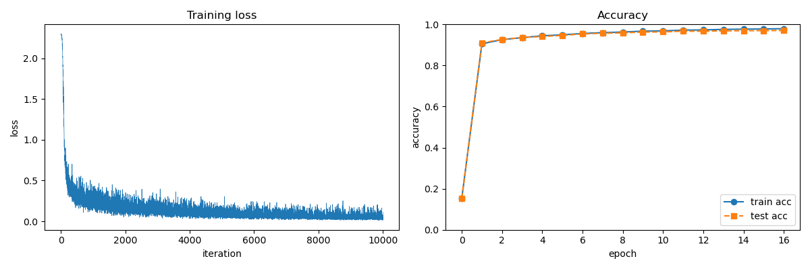

# 01. MNIST 手書き数字分類（2層ニューラルネット）

誤差逆伝播法で学習する2層ニューラルネットワークを NumPy だけで実装し、MNIST の手書き数字（0〜9）を分類しました。

- **テスト精度：約97%**（10,000枚）
- 逆伝播の勾配を数値微分と比較し、実装の正しさを確認
- 自信満々で間違えた画像を可視化して、誤分類の傾向を分析

## ネットワーク構成

```
入力 (N, 784) → Affine1 → ReLU → Affine2 → Softmax-with-Loss
                (784→50)          (50→10)
```

| 項目 | 値 |
|---|---|
| 入力 | 28×28 画素を平坦化した 784 次元（0〜1 に正規化） |
| 隠れ層 | 50 ニューロン、活性化関数 ReLU |
| 出力 | 10 クラス、Softmax + 交差エントロピー誤差 |
| 重みの初期値 | 標準偏差 0.01 の正規分布 |
| 最適化 | SGD（学習率 0.1）、ミニバッチ 100、10,000 イテレーション（約17エポック） |

## ファイル構成

```
01_mnist_2layer/
├── dataset/
│   └── mnist.py          # MNIST の読み込み（公式リポジトリのもの）
├── functions.py          # softmax、交差エントロピー誤差、数値微分
├── layers.py             # Relu / Affine / SoftmaxWithLoss レイヤ
├── two_layer_net.py      # レイヤを組み立てたネットワーク本体
├── gradient_check.py     # 逆伝播と数値微分の勾配を比較
├── train.py              # 学習・グラフ描画・パラメータ保存
└── predict.py            # 学習済みパラメータで推論し、結果を可視化
```

## 実装のポイント

### 1. 各レイヤの逆伝播

すべてのレイヤが `forward(x)` と `backward(dout)` を持ち、`backward` は上流の勾配 `dout` を受け取って下流への勾配 `dx` を返す、という共通の形にしています。これにより、ネットワーク本体ではレイヤを逆順にたどるループだけで逆伝播が書けます。

**Affine レイヤ**（$Y = XW + b$）では、連鎖律から次の勾配を求めます。

$$\frac{\partial L}{\partial X} = dout \cdot W^T,\qquad \frac{\partial L}{\partial W} = X^T \cdot dout,\qquad \frac{\partial L}{\partial b} = \sum_{n} dout_n$$

$W$ と $b$ はバッチ内の全画像で共有されているため、それらの勾配は画像方向に和をとる形になります。

**Softmax-with-Loss レイヤ**では、Softmax と交差エントロピー誤差を合わせて微分すると、指数と対数が打ち消し合い、

$$\frac{\partial L}{\partial a_k} = y_k - t_k$$

という「予測 − 正解」の単純な形になります（バッチでは $N$ で割る）。

### 2. 勾配確認

逆伝播で求めた勾配と、中心差分による数値微分の勾配を、訓練データ3枚で比較しました（差の絶対値の平均）。

| パラメータ | 差 |
|---|---|
| W1 | 4.1e-10 |
| b1 | 2.3e-09 |
| W2 | 4.8e-09 |
| b2 | 1.4e-07 |

いずれも十分小さく、逆伝播が正しく実装できていることを確認できました。なお、この方法は「backward が forward を正しく微分しているか」を確かめるもので、forward 自体の誤りは検出できません。forward の正しさは、学習前の損失が $-\log(1/10) \approx 2.30$ になっていることと、学習で精度が上がることで確認しています。

### 3. パラメータとレイヤの参照の共有

`TwoLayerNet` の `params['W1']` と `Affine1` の `W` は**同じ NumPy 配列を参照**しています。そのため、

- 学習時の更新は `params[key] -= lr * grad[key]` のように**その場で書き換える**必要があります。`params[key] = params[key] - ...` と書くと新しい配列が作られ、レイヤ側の重みが更新されません。
- 推論時に保存済みパラメータを読み込むときも、`params[key][...] = loaded[key]` として配列の中身だけを書き換えています。

## 結果

### 学習曲線



- 学習前の損失は約 2.3（10クラスを等確率で予測した場合の値）で、最初の数百イテレーションで急速に減少しました。
- 1エポックで精度は約90%に達し、最終的に訓練データで約98%、テストデータで約97%になりました。
- 訓練とテストの精度の差が小さく、過学習はほとんど起きていません。

### 推論結果

ランダムに選んだテスト画像では、ほぼすべて正しく分類できました。


### 自信満々で間違えた画像

誤分類した画像のうち、予測確率が高かった上位10枚です（赤字：予測 / 正解）。


- 正解ラベル「3」を「8」と予測したものや、「8」を「4」と予測したものなど、人間が見ても判別が難しい、あるいはモデルの予測のほうが妥当に見える画像が多く含まれていました。
- 一方で、間違えているにもかかわらず予測確率が 99〜100% になっており、**Softmax の出力が実際の正しさの確率を表しているとは限らない**（過信）ことがわかります。
- このモデルは画像を 784 次元のベクトルとして扱っており、線のつながりや形といった空間的な構造を直接は利用していません。この点は、今後実装する CNN で改善される見込みです。

## 実行方法

`01_mnist_2layer` フォルダで実行してください（初回は MNIST のダウンロードが行われます）。

```bash
# 逆伝播の勾配確認
python gradient_check.py

# 学習（グラフを表示し、params.npz にパラメータを保存）
python train.py

# 学習済みパラメータで推論・可視化
python predict.py
```

## 学んだこと

- 誤差逆伝播法を「計算グラフの各ノードで局所的な微分を掛けて流す」処理として、レイヤ単位で実装できること
- 共有されたパラメータ（W, b）の勾配はバッチ方向に和をとる、という連鎖律の構造
- 数値微分による勾配確認が、実装のデバッグに有効であること
- Python のオブジェクト参照の仕組みが、パラメータ更新の正しさに直結すること
- 分類精度だけでなく、誤分類の中身を見ることで、データやモデルの限界が見えること
